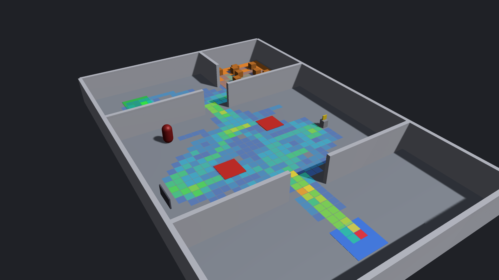
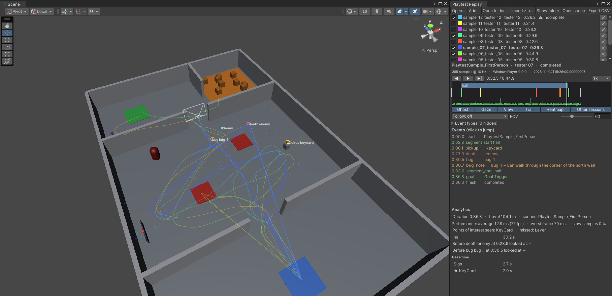
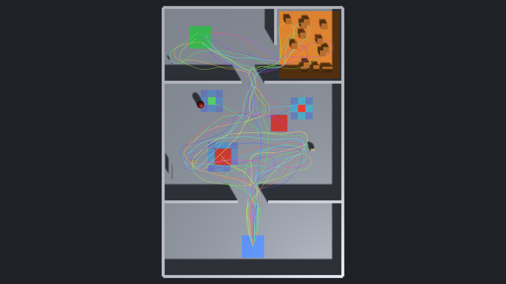
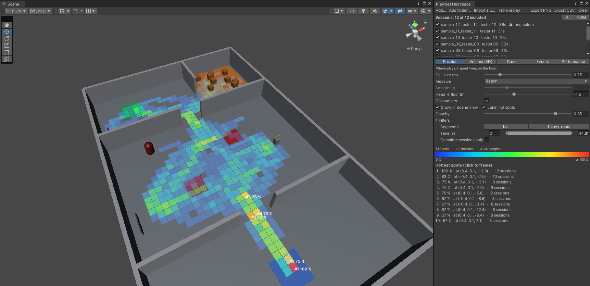
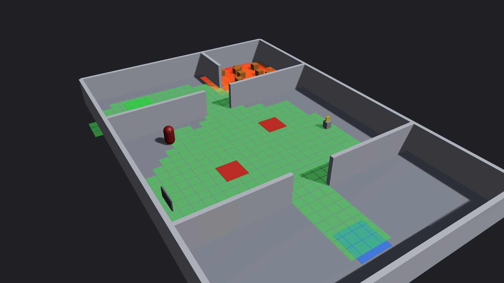
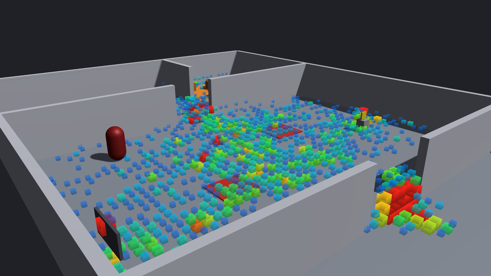
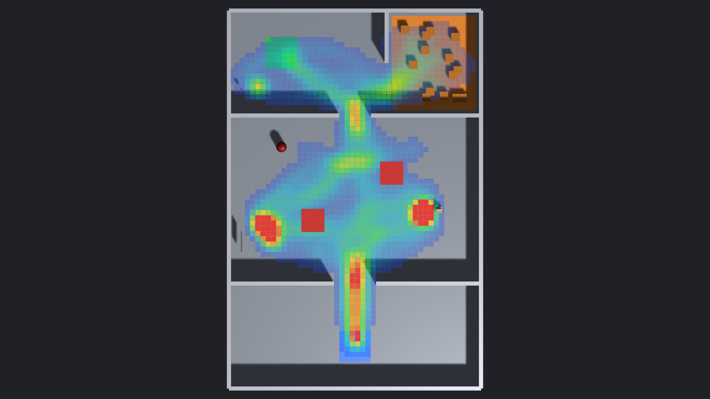
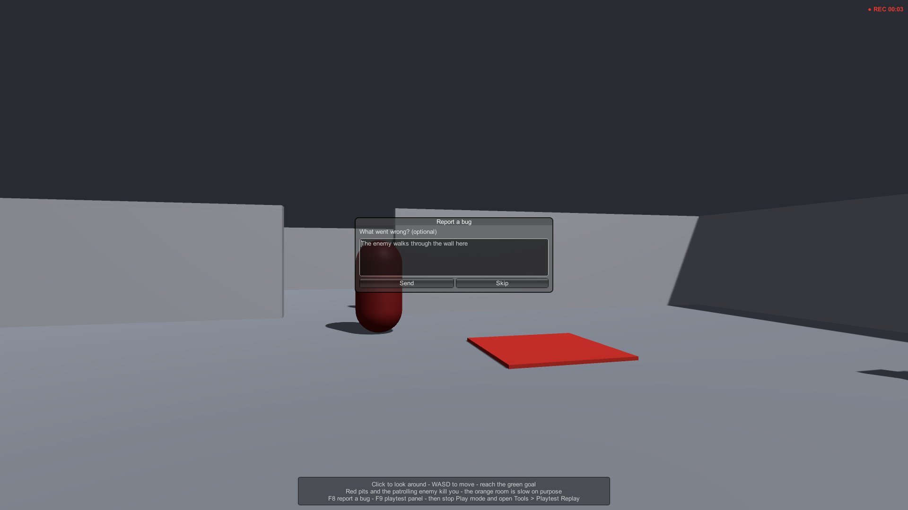

# Playtest Replay & Heatmaps for Unity

[Manual](manual/) · [Changelog](changelog/) · [Support](#support)

Record your playtesters, replay their sessions in the Scene view and turn many sessions into heatmaps: where they went,
what they looked at, where they died and where the game ran slowly. Local files, no server needed.

Unity 2022.3 LTS and Unity 6 · Built-in, URP and HDRP · Mono and IL2CPP · flat screen and VR · no dependencies, full C# source.

## Get started

1. Add **Playtest Recorder** to your first scene.
2. Log what matters: `Playtest.Log("death", "lava", "", position);`
3. Send the build to testers. They press **F8** to report a bug with a screenshot and **F9** to export their sessions as a zip.
4. In the Editor: **Tools ▸ Playtest Replay ▸ Replay Window**, then **Heatmaps**.

Full details are in the [manual](manual/). The same manual is included in the package under `Documentation/`.

## Record

- Camera/head, hands (VR), gaze, any number of moving objects, frame times, scene changes
- Your own events in one line, timed segments, bug reports
- Written while the game runs: a crash loses at most a few seconds, and the replay marks the session as incomplete
- 10 samples per second by default, about 1–2 MB per hour, nothing allocated in frames without a sample

## Replay

Ghost, gaze ray, view frustum, trail and tracked objects in the Scene view. A timeline with segments, event markers and a
frame-time strip. First- and third-person follow camera. Up to 64 sessions on one playhead. Analytics: points of interest
seen or missed, time per segment, what players looked at before they died.

## Heatmaps

Position (floor), Volume (3D), Gaze, Events and Performance. Measure time spent, or *reach*: how many testers got to each
spot. Filter by scene, segment, time, event type and session. Export a top-down PNG with placement data, or CSV.

## Collect from testers

- **F8**: bug report with a screenshot and a note, placed on the replay timeline
- **F9**: consent toggle, one-click zip of all sessions, open sessions folder
- Optional upload to your own server (form POST; a sample receiver is in the [manual](manual/#playtest-uploader))
- Consent switch and a random install id instead of personal data

## Support

E-mail: devirosnguyen@gmail.com

When reporting a problem, please include your Unity version, render pipeline and the Console log.

---

This repository contains documentation only. Playtest Replay & Heatmaps is sold on the Unity Asset Store by JieYingStudio.
