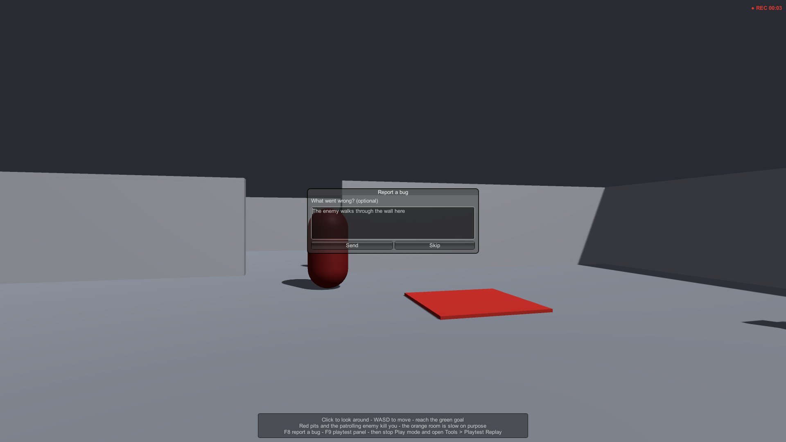
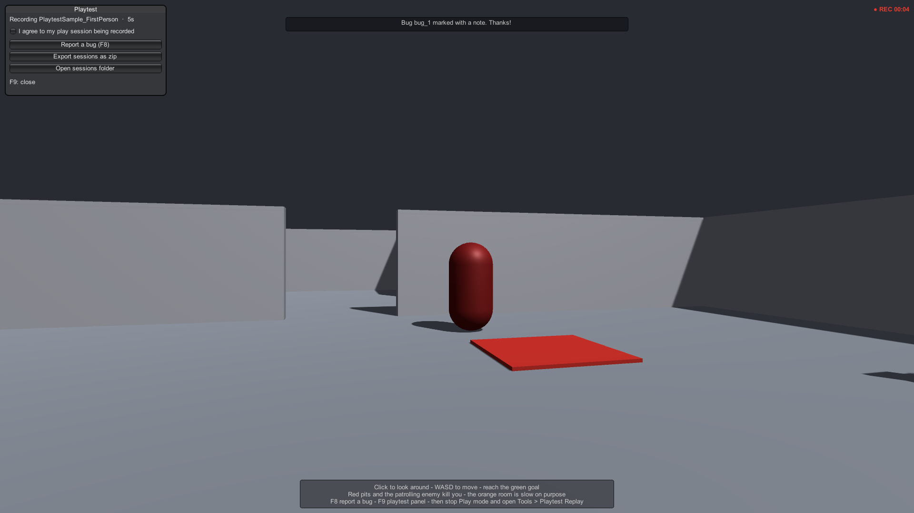
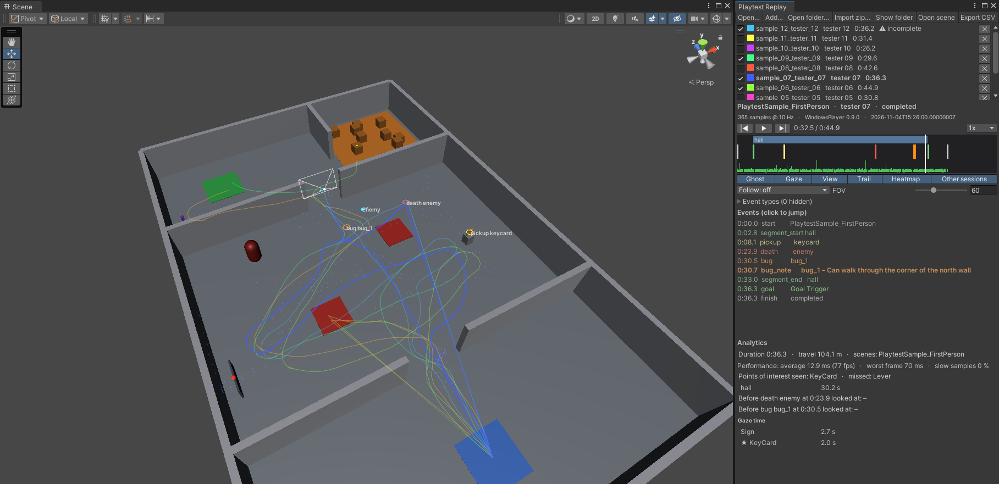
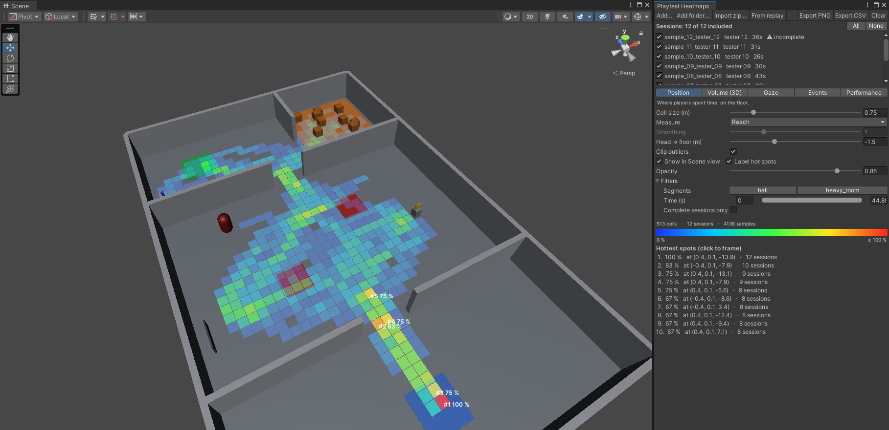
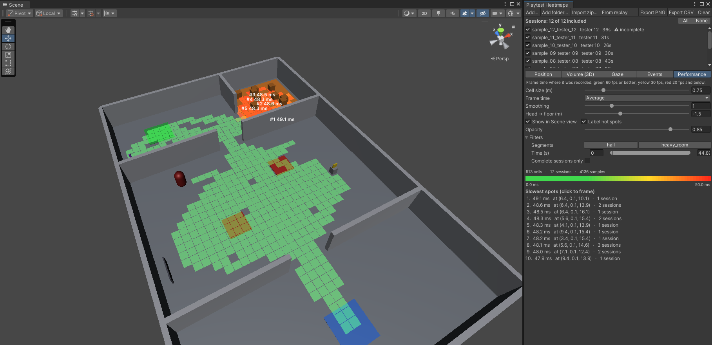

# Playtest Replay & Heatmaps – Manual

[Home](../) · [Changelog](../changelog/)

Version 1.0 · Unity 2022.3 LTS and Unity 6 · Built-in, URP and HDRP · pure C#, no native plugins (tested in Windows builds with Mono and IL2CPP)

Record what your playtesters do, then watch it back and see the patterns:

- **Recorder** – head/camera pose, hands, gaze, any number of tracked objects, frame times, scene changes and your own events, written to disk while the game runs (a crash loses at most a few seconds).
- **Replay window** – ghost, gaze ray, view frustum, trail, tracked objects and events in the Scene view; timeline with segments, event markers and a frame-time strip; follow camera; several sessions overlaid on one playhead.
- **Heatmaps window** – position (floor or 3D), gaze, events and performance over any number of sessions, with filters, smoothing, PNG and CSV export.
- **Tester tools** – bug key with screenshot and note, one-click zip export, optional upload to your own server, consent switch.

No package dependencies. Input System, XR and the Test Framework are used only when present.

---

## 1. Quick start (5 minutes)

1. Open `Samples/Scenes/PlaytestSample_FirstPerson` and press Play. Walk around (click to look, WASD), fall into a red pit, press **F8** to report a bug, reach the green goal.
2. Stop Play mode. Open **Tools ▸ Playtest Replay ▸ Replay Window ▸ Open…** – the newest file in the sessions folder is your run. Press ▶.
3. Open **Tools ▸ Playtest Replay ▸ Open Sample Sessions** to load 12 pre-recorded sessions, then **Heatmaps** in the replay toolbar.

### In your own game

1. Add an empty GameObject with **Playtest Recorder** to your first scene. It records the main camera by default; assign *Viewer* (and *Left/Right Hand* for VR) to record something else.
2. Optional: add **Playtest Target** to objects whose gaze time you want measured (tick *Point Of Interest* for things players should notice), **Playtest Tracked** to moving objects you want to see in the replay, **Playtest Overlay** for the tester keys, **Playtest Uploader** to send sessions to your server.
3. Log what matters from your code:

```csharp
using JieYingStudio.PlaytestReplay;

Playtest.Log("death", "lava", "fell in", player.position);   // type, id, text, position (optional)
Playtest.BeginSegment("level_2");                           // timed sections, shown on the timeline
Playtest.EndSegment("level_2");
Playtest.ReportBug("stuck behind the crate");               // event + screenshot
```

Calls do nothing when nothing is recording, so they can stay in release code.

---

## 2. Components

### Playtest Recorder

| Setting | Default | Meaning |
|---|---|---|
| Auto Start | on | Start a session when the scene starts. Otherwise call `BeginSession()`. |
| Persist Across Scenes | on | The recorder survives scene loads, so one session can span several levels. If the scene with the recorder is loaded again, the running recorder is kept and the new copy removes itself. |
| Label | – | Free text stored in the session (tester, build, level). |
| Sample Rate | 10 Hz | Samples per second (1–30). 10 Hz is enough for replay and heatmaps; files stay around 1–2 MB per hour. |
| Development Builds Only | off | Record only in the Editor and development builds. |
| Require Consent | off | Record only after `Playtest.SetConsent(true)`. See *Privacy*. |
| Viewer / Left Hand / Right Hand | main camera / none | Transforms that are recorded. For VR: the HMD camera and the controller (or hand) transforms. |
| Record Gaze, Gaze Distance, Gaze Mask | on, 30 m, everything | A ray from the viewer: what is hit is the gaze point; if it belongs to a Playtest Target, gaze time is counted. |
| Seen Seconds | 0.5 | Gaze time needed to count a point of interest as seen. |
| Record Frame Time | on | Average and worst frame time per sample (performance heatmap and timeline strip). |
| Save To Disk | on | Write to `Playtest.Folder`. Off = keep in memory (`Current`). |
| Flush Interval | 5 s | How often data is written. A crash loses at most this much. |
| Max File Megabytes | 50 | When reached, samples stop but events are still recorded (a `size_limit` event marks the moment). |

Events written by the recorder itself: `start`, `finish`, `scene`, `segment_start`, `segment_end`, `size_limit`, `bug`, `bug_note`.

API: `BeginSession(label)`, `EndSession(outcome)` (returns a `SessionSummary` and writes `<file>_summary.json`), `ReportBug(note, screenshot, callback)`, `Flush()`, `Current`, `CurrentPath`, `LastSavedPath`, event `SessionSaved`.

### Playtest Target
Marks an object (with a collider) as something players can look at. *Id* (default: object name) and *Point Of Interest*. The analytics list gaze time per target and which points of interest were seen or missed.

### Playtest Tracked
Records the object's position and rotation with every sample – enemies, vehicles, the ball, the player avatar in third person. Objects may appear and disappear during a session.

### Playtest Overlay (flat-screen builds)
A small IMGUI layer for testers: **REC** indicator, **F8** report a bug (screenshot without the overlay, then a note box; optional pause while typing), **F9** panel with the consent toggle, *Export sessions as zip* (path copied to the clipboard), *Open sessions folder*, *Upload now*. Keys can be changed. IMGUI is not visible in VR headsets – see *VR*.





### Playtest Uploader
Sends finished sessions to your own server, one `multipart/form-data` POST per session:

| Field | Content |
|---|---|
| `sessionFile` | file name of the `.ptrec` |
| `installId` | random id created once per install (no personal data) |
| `product`, `version`, `platform` | from Application |
| `files[]` | the `.ptrec`, its `_summary.json` and any bug screenshots |

Any 2xx response counts as received; the files are then moved to `Uploaded/` (or deleted). Failed sessions stay and are retried next time. *When*: manually, after each session, or on start and after each session. *Require Consent* is **on by default**. An optional header (for example `Authorization: Bearer …`) is sent with every request – anything inside a build can be extracted, so use a token that can only upload.

A minimal receiver (Python 3, Flask):

```python
from flask import Flask, request
import os, re
app = Flask(__name__)
ROOT = "received"

@app.post("/playtest/upload")
def upload():
    if request.headers.get("Authorization") != "Bearer change-me":
        return "forbidden", 403
    folder = os.path.join(ROOT, re.sub(r"[^A-Za-z0-9_-]", "_", request.form.get("installId", "unknown")))
    os.makedirs(folder, exist_ok=True)
    for f in request.files.getlist("files[]"):
        name = os.path.basename(f.filename)
        if name.endswith((".ptrec", ".json", ".jpg", ".png")):
            f.save(os.path.join(folder, name))
    return "ok"

app.run(host="0.0.0.0", port=8080)
```

Put it behind HTTPS for anything beyond a local test.

### Static API – `Playtest`

| Member | |
|---|---|
| `Log(type, id, text[, position])` | Add an event to the active session. |
| `BeginSegment(id)`, `EndSegment(id)` | Timed sections. |
| `ReportBug(note, screenshot)`, `AddBugNote(id, note)` | Bug reports. |
| `HasConsent`, `SetConsent(bool)` | Stored in PlayerPrefs. Withdrawing consent ends the running session (`consent_withdrawn`). |
| `Folder` | `Application.persistentDataPath/PlaytestReplay` |
| `Active`, `IsRecording`, `InstallId` | |

`PlaytestFiles`: `Sessions(folder)`, `CreateZip(path, folder)`, `ExtractZip(zip, destination)` (only session file types, paths flattened), `MarkUploaded`, `ScreenshotPath`.

---

## 3. Replay window (Tools ▸ Playtest Replay ▸ Replay Window)



- **Open / Add / Open folder / Import zip** – one session, several to compare, a whole folder (up to 64), or a zip a tester sent (extracted to `Imported/<zip name>`).
- **Session list** – visibility, colour, ✕ to remove; click a name to make it the primary session (its events, timeline and analytics are shown).
- **Timeline** – segments on top, event markers, frame-time strip at the bottom (green < 16.7 ms, yellow < 33.3 ms, red above). Hover for details, click or drag to scrub, |◀ ▶| jump between events.
- **Display** – Ghost (head and hands), Gaze, View (camera frustum, FOV slider), Trail, Heatmap (gaze of the primary session), Other sessions. Follow camera: off, third person, first person.
- **Events** – click to jump; bug events have a *Screenshot* button. Filter event types with the foldout.
- **Analytics** – duration, distance travelled, scenes, performance, points of interest seen/missed, segment times, what the player looked at before each death/failure/bug, gaze time per target.
- **Open scene** opens the scene the session was recorded in; **Export CSV** writes frames, events and the summary.

Sessions marked *incomplete* have no closing chunk: the game crashed, was killed or is still recording. Everything up to the last write is shown.

## 4. Heatmaps window (Tools ▸ Playtest Replay ▸ Heatmaps)



| Kind | Shows |
|---|---|
| Position | Where players spent time, on the floor (drawn at each cell's data height + *Head → floor*). |
| Volume (3D) | The same in voxels – several storeys, ladders, flying. |
| Gaze | Where gaze rays hit. |
| Events | Where events happened (deaths, bugs, pickups…). Events without a position use the player's position at that moment. Bookkeeping events are left out. |
| Performance | Average or worst frame time by location. |

- **Measure**: *Total* (seconds, or events) or *Reach* – the share of sessions that got to a cell ("how many testers made it here").
- **Filters**: scenes, segments (sessions without the segment are left out of the count), time from session start, event types, complete sessions only, and the session check boxes.
- **Smoothing** (floor maps), **Clip outliers** (colour scale to the 98th percentile), opacity, labels for the five hottest cells. The *Hottest spots* list frames the Scene view on a click.
- **Export PNG** writes a top-down image (+X right, +Z up, transparent where empty) and a JSON file with its world origin, size and scale. **Export CSV** writes one row per cell.

The heatmap is one mesh drawn in the Scene view, so thousands of cells stay fast. Up to 256 sessions can be aggregated.



---

## 5. VR (Meta Quest, OpenXR, …)

- Set *Viewer* to the HMD camera and *Left/Right Hand* to the controller or hand transforms. Gaze is the head direction (not eye tracking).
- The IMGUI overlay does not show in the headset. Call `Playtest.ReportBug()`, `PlaytestFiles.CreateZip()` and `Playtest.SetConsent()` from your own world-space menu or a controller button.
- On Android, `Playtest.Folder` is inside the app's private storage: use the uploader, or pull files with `adb pull /sdcard/Android/data/<package>/files/PlaytestReplay`.

## 6. Privacy and consent

Session files contain how a person moved and looked, timing and anything you log. Treat them as personal data:

- Tell testers what is recorded and why; for anything beyond your own team, ask first – tick *Require Consent* on the recorder and the uploader, and call `Playtest.SetConsent(true)` from your consent screen (the overlay panel has a toggle).
- Do not log names, e-mails or free text you do not need. The uploader sends a random install id, never a device id.
- Keep uploads on HTTPS and delete data you no longer need. Follow the law that applies to your testers (e.g. GDPR).

## 7. File format

`.ptrec` is a binary file of independently gzip-compressed chunks (header, scenes, objects, gaze targets, samples, events, footer) written as the game runs. A missing footer marks an incomplete session; readers stop at the last complete chunk and skip unknown chunk types, so newer files stay readable by older readers where possible. `SessionRecording.Load(path)` reads it; `SessionAnalytics.FramesCsv/EventsCsv` convert it.

## 8. Performance

Measured in a Windows build (Unity 2022.3, Mono, 60 fps, sample scene, 1 tracked object): **no allocations in frames without a sample**; each sample (10 per second) stores its own data, about 4 KB/s in total; each write to disk allocates about 13 KB (every 5 s by default). Gaze uses one raycast per sample.

## 9. Troubleshooting

| Problem | Fix |
|---|---|
| No files in the folder | Check *Save To Disk*, *Require Consent* (consent given?), *Development Builds Only*. The Console shows where each session was saved. |
| Gaze targets never hit | The target needs a collider on a layer in *Gaze Mask*; triggers count. |
| Floor heatmap at the wrong height | Adjust *Head → floor*; for several storeys use *Volume*. |
| Sample geometry pink/dark | The samples use the active pipeline's default material; HDRP may need exposure/sky settings in your project. |

## 10. Support

E-mail: devirosnguyen@gmail.com – please include your Unity version, render pipeline and the Console log.
